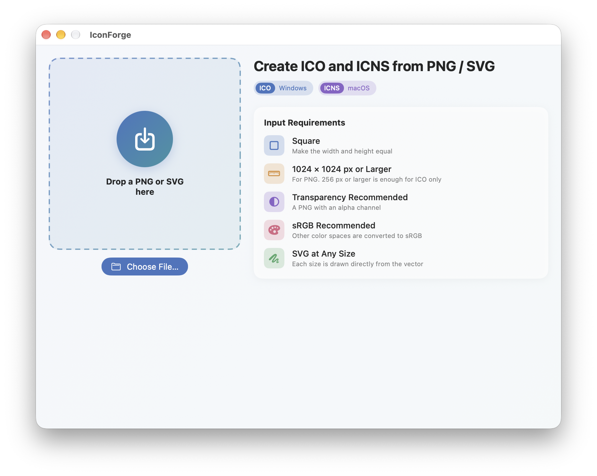
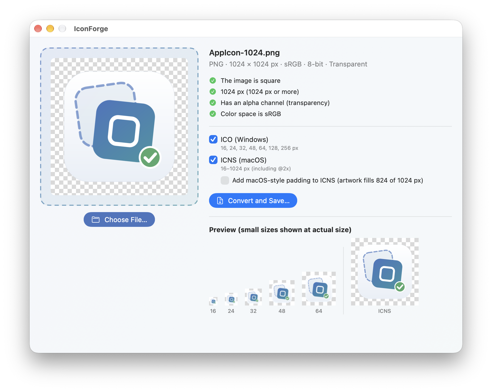

# IconForge

IconForge is a macOS app built with SwiftUI. It turns a PNG or SVG into multi-resolution icon files:
**ICO** for Windows and **ICNS** for macOS.

## Features

- Drag and drop a PNG or SVG, or choose one with **Choose File…**
- Checks the source against the icon requirements and shows the results
- Writes a multi-size ICO and a full ICNS (including @2x sizes) in one step
- Can add macOS-style padding to the ICNS (the artwork fills 824 of 1024 px)
- Shows the small sizes at actual size, so you can check how they look before saving
- Fixed-size window
- Available in English, Japanese, French, German, Italian, Spanish, Portuguese (Brazil),
  Traditional Chinese and Simplified Chinese

## Requirements

- macOS 14 Sonoma or later

## Source Requirements

|              | PNG                                                         | SVG                                                |
| ------------ | ----------------------------------------------------------- | -------------------------------------------------- |
| Square       | Required                                                    | Required (aspect ratio of width/height or viewBox) |
| Size         | 256 px or more for ICO, 1024 px or more for ICNS            | Any size                                           |
| Transparency | Recommended (a warning is shown if there is none)           | —                                                  |
| Color space  | sRGB recommended (other color spaces are converted to sRGB) | —                                                  |

Output formats that the source can't meet are disabled.

SVG files are drawn with `NSImage`. Some SVG features, such as filters, CSS and web fonts,
may not render correctly, so check the preview before saving.

## Output

- **ICO**: 16, 24, 32, 48, 64, 128 and 256 px
  - 256 px is stored as PNG; smaller sizes are stored as 32-bit BMP for compatibility with older tools
- **ICNS**: icp4 (16), icp5 (32), ic11 (16@2x), ic12 (32@2x), ic07 (128), ic13 (128@2x),
  ic08 (256), ic14 (256@2x), ic09 (512), ic10 (512@2x)
  - Every entry is stored as PNG

The files are named after the source: `<name>.ico` and `<name>.icns`.

## Localization

| Language            | Code      |
| ------------------- | --------- |
| English             | `en`      |
| Japanese            | `ja`      |
| French              | `fr`      |
| German              | `de`      |
| Italian             | `it`      |
| Spanish             | `es`      |
| Portuguese (Brazil) | `pt-BR`   |
| Traditional Chinese | `zh-Hant` |
| Simplified Chinese  | `zh-Hans` |
